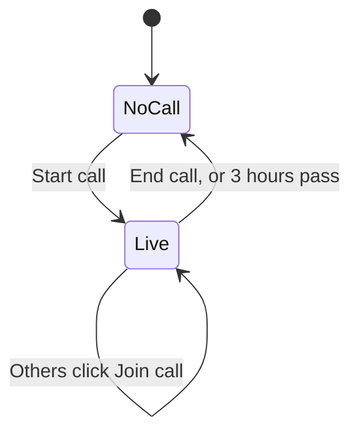
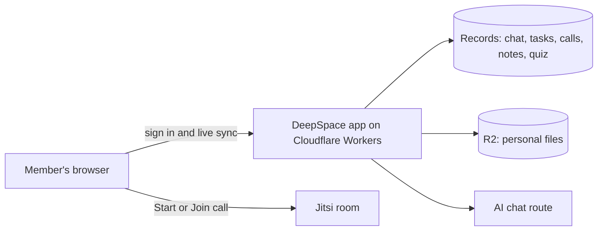

<div align="center">

# 📚 StudyRoom Live

**One shared room where a study group chats, co-edits notes, tracks tasks, quizzes each other, and hops on a call, without anyone needing to host.**

[](https://studyroom-live.app.space)


[**Open the app →**](https://studyroom-live.app.space/home)

</div>

---

## ✨ What's inside

| | Feature | How it works |
|---|---|---|
| 💬 | **Chat** | One public channel for the whole room (DeepSpace messaging). |
| 📝 | **Shared notes** | Real-time collaborative documents with live cursors (Tiptap + Yjs). |
| ✅ | **Study tasks** | A shared task list everyone can add to (items collection). |
| 📁 | **My files** | Personal file storage on R2. Each member's files are private to them. |
| 📞 | **Study call card** | Shows **Start call** or **Join call** depending on whether a call is live. Updates for everyone in real time. |
| ⭐ | **Quiz** | The room builds one shared question bank together. Everyone plays solo, and a leaderboard ranks best runs with stars. |
| 🤖 | **AI assistant** | DeepSpace AI chat is wired in. See [known limitations](#-known-limitations). |

## 📞 The call card, the part I built from scratch

Each call is its own record in a `calls` collection (status, who started it,
when). The home page subscribes to it, so the button changes for everyone the
moment someone starts or ends a call.



- Only the **starter or an admin** can end a call.
- A call still marked live after **3 hours** is treated as ended, so a forgotten
  call never locks the room.
- The meeting is a **fixed Jitsi room** (`src/constants.ts`), so nobody needs a
  host account or has to admit anyone. The room name is public in this repo, so
  anyone who has it can join.

Code: [`CallCard.tsx`](src/components/CallCard.tsx) and
[`calls-schema.ts`](src/schemas/calls-schema.ts).

## ⭐ The quiz, also built from scratch

Two collections of my own, `quiz-questions` and `quiz-attempts`. The room
builds one shared question bank together, then everyone takes the quiz on
their own. Questions shuffle every run, and each answer gets instant right
or wrong feedback.

- The leaderboard ranks players by their best run, with a star rating from
  that score (5 stars at 90% or better).
- Every finished run is saved, so the board and recent scores survive a
  refresh.
- Any member can add questions. You can only change or delete your own.

Code: [`quiz.tsx`](src/pages/(app)/(protected)/quiz.tsx) and
[`quiz-schema.ts`](src/schemas/quiz-schema.ts).

## 🧩 How it fits together



## 🧠 Design decisions

| Decision | Why |
|---|---|
| **One room, not many** | DeepSpace's messaging schemas are built for public channels. Private rooms need server-enforced scoping on messages first, so I shipped one room I could fully verify. |
| **Files stay personal** | The platform's file permissions are owner-only or open to every signed-in user. I chose owner-only over leaking file keys to everyone. |
| **Jitsi instead of Meet** | A Google Meet link belongs to someone's calendar, so joiners wait for that person to admit them. A Jitsi room has no host. |
| **Guard in `chat.tsx`** | Reloading chat threw a duplicate read-receipt error. The SDK's `useReadReceipts` can create a receipt before its query has loaded. The page now waits until receipts are ready. |
| **Login at the front door** | The scaffold shipped a static landing page at the root. I took it out, along with the build step that prerendered it, and put the root route behind the sign-in gate. The link now opens on a sign-in page, and signed-in users go straight to the room. |

## 🚀 Run it locally

```bash
npm install
npx deepspace auth login
npx deepspace dev start
```

Secrets live in `.dev.vars`, which is git-ignored and not part of this repo.

## ⚠️ Known limitations

- **The AI assistant returns "payment required"** on the deployed app, even though
  the account has unused credits. I tried per-user billing and billing the app
  owner, and neither cleared it. I left the integration in place and did not add
  a payment method to force it.
- Chat is one public channel. Any signed-in user can read and post.
- One room only.

## 🔭 What I'd build next

1. **Multiple rooms** with server-enforced scoping on messages.
2. **Room-shared files** behind a membership check.
3. A **publish to notes** button that saves an AI summary into the shared document.
